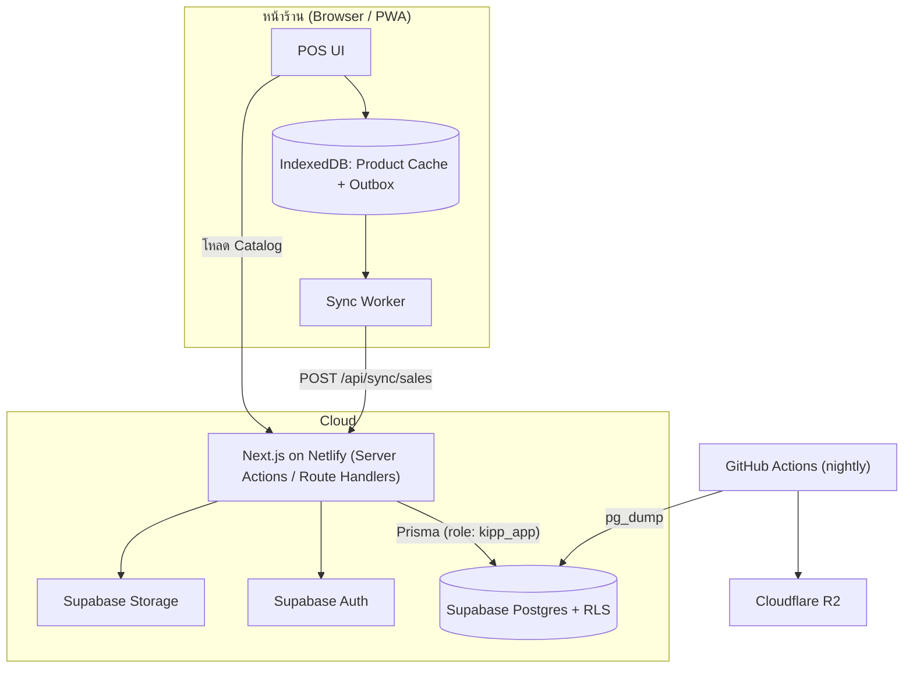
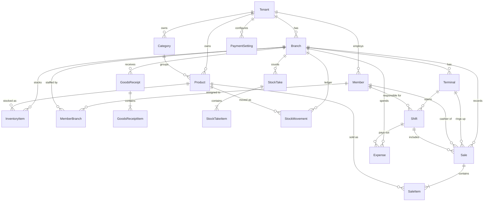
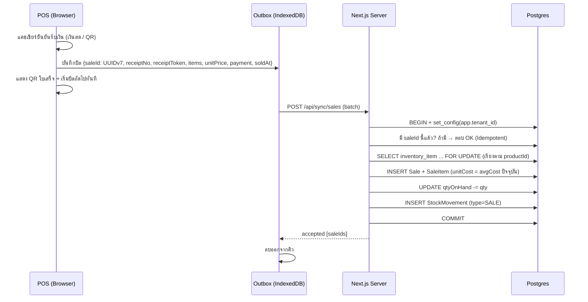
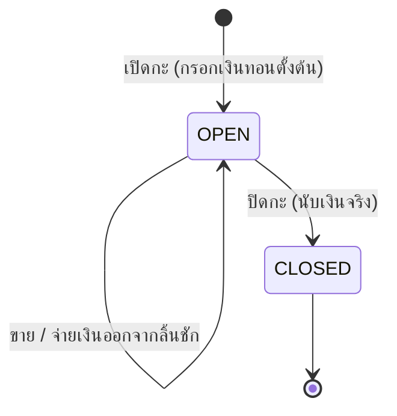

# Kipp Market — Design Doc (v0.3)

> **สถานะ:** v0.3 — ตัดสินใจครบทุกข้อ พร้อมเริ่ม Phase 0 · **วันที่:** 2026-10-20
> **ขอบเขต:** Hosted SaaS POS + Retail Management สำหรับร้านสะดวกซื้อ ฟรีทุกฟีเจอร์ (ช่วง Beta บน Free Tier)
> **กลุ่มเป้าหมาย:** ① ร้านเล็กที่ยังไม่มีระบบขาย/สแกนจ่ายของตัวเอง ② ร้านใหญ่ที่อยากเปลี่ยนมาใช้ระบบเรา

---

## 1. เป้าหมาย / สิ่งที่ไม่ทำ

### 🎯 เป้าหมาย (v1)
1. **POS เร็ว:** สแกนบาร์โค้ดได้โดยไม่ต้องคลิกช่องกรอก มีตะกร้าสินค้า และรับเงินสด/QR PromptPay ล็อคยอด
2. **ขายต่อได้ตอนเน็ตหลุด:** เมื่อเน็ตกลับมา บิลจะ Sync ขึ้นเซิร์ฟเวอร์โดยไม่หายและไม่ซ้ำ
3. **คลังสินค้า:** หักสต็อกอัตโนมัติ, รับสินค้าเข้าพร้อมคิดต้นทุนแบบ Moving Average และหน้านับสต็อกที่คำนวณ Variance
4. **กำไรแม่นยำ:** ล็อคต้นทุนในทุกรายการขาย และหักค่าใช้จ่ายจิปาถะ เพื่อให้ได้กำไรสุทธิ
5. **SaaS Multi-Tenant:** ร้านสมัครเองได้ และข้อมูลแต่ละร้านแยกกันเด็ดขาด
6. **ใช้ได้ทั้งร้านเล็กและร้านใหญ่:** ร้านเล็กที่ไม่มีเครื่องสแกนใช้ **กล้องมือถือ/แท็บเล็ต** และ **ปุ่มสินค้าด่วน** แทนได้ ส่วนร้านใหญ่รองรับสินค้าหลักหมื่นรายการ หลายเครื่อง POS และบาร์โค้ดจากตาชั่ง
7. **สินค้าชั่งน้ำหนัก:** ขายเป็นทศนิยมได้ (เช่น เนื้อสัตว์ 0.350 กก.)
8. **กะและลิ้นชักเงิน:** เปิดกะด้วยเงินทอนตั้งต้น และปิดกะด้วยการนับเงินจริงเทียบกับยอดที่ระบบคำนวณ

### 🚫 ไม่ทำใน v1
Billing / แพ็กเกจ, การแสดง VAT บนใบเสร็จ, ส่วนลด (ทุกรูปแบบ), หน้าสลับร้าน (เจ้าของหลายร้าน — ทำภายหลัง ดูข้อ 7.14), เชื่อมต่อตาชั่งผ่านสายโดยตรง, จอแสดงผลฝั่งลูกค้า, ตรวจสลิป, e-Tax Invoice, พิมพ์ใบเสร็จผ่าน Thermal Printer, คืนสินค้าบางรายการ (Partial Return), โอนสต็อกข้ามสาขา, โปรโมชัน/สมาชิกสะสมแต้ม, ยืนยันการจ่ายเงินอัตโนมัติผ่าน Payment Gateway

---

## 2. Tech Stack

| Layer | เทคโนโลยี |
|---|---|
| App (Frontend + Backend) | Next.js (App Router) + React 19 + TypeScript |
| Database | Supabase PostgreSQL (Region: Singapore) |
| ORM | Prisma (`DATABASE_URL` ผ่าน Supavisor :6543 / `DIRECT_URL` :5432 สำหรับ Migration) |
| Auth | Supabase Auth (เจ้าของร้าน/Manager) + Custom PIN — `argon2id` + `jose` JWT (พนักงาน) |
| UI | Tailwind CSS v4 + shadcn/ui + Recharts |
| State / Validation | Zustand / Zod + React Hook Form |
| Offline | Serwist (Service Worker) + Dexie.js (IndexedDB) + UUID v7 |
| QR | สร้าง PromptPay Payload (EMVCo) ฝั่ง Client + `qrcode` |
| Camera Scan | `BarcodeDetector` API (Chrome/Android) + `@zxing/browser` เป็นตัวสำรอง (iOS Safari) |
| Storage | Supabase Storage (รูปสินค้า) |
| Email | Resend |
| Hosting | Netlify Free + Supabase Free |
| Backup | GitHub Actions `pg_dump` ทุกคืน → Cloudflare R2 |
| Test | Vitest + Playwright |

---

## 3. ภาพรวมสถาปัตยกรรม



**หลักการสำคัญ:**
- **Server เป็นแหล่งข้อมูลจริง (Source of Truth)** ของสต็อกและต้นทุน ส่วน Client เก็บแค่ Cache ราคาขายกับคิวบิล
- **Outbox-First:** บิล **ทุกใบ** ถูกเขียนลง IndexedDB ก่อน แล้วค่อยส่งขึ้นเซิร์ฟเวอร์ทันที ทำให้ตอนออนไลน์และออฟไลน์ใช้โค้ดเส้นทางเดียวกัน จึงไม่มีบั๊กที่เกิดเฉพาะโหมด Offline
- **เครื่อง POS ไม่ได้รับข้อมูลต้นทุนเลย:** ต้นทุนถูกล็อคฝั่งเซิร์ฟเวอร์ (ดูหัวข้อ 7.2)

---

## 4. Multi-Tenancy และความปลอดภัยของข้อมูล

### 4.1 ลำดับชั้น
`Platform → Tenant (ร้าน) → Branch (สาขา) → Terminal (เครื่อง POS) → Member (พนักงาน)`

### 4.2 แยกข้อมูล 2 ชั้น
1. **ชั้นแอป:** ทุก Query ผ่าน Prisma Client ที่ผูก `tenantId` จาก Session แล้วเท่านั้น
2. **ชั้นฐานข้อมูล (RLS):** ทุกตารางที่มี `tenant_id` เปิด RLS ไว้

```sql
-- ตัวอย่าง Policy (ทำแบบเดียวกันทุกตารางที่มี tenant_id)
ALTER TABLE sale ENABLE ROW LEVEL SECURITY;
CREATE POLICY tenant_isolation ON sale
  USING (tenant_id = current_setting('app.tenant_id')::uuid)
  WITH CHECK (tenant_id = current_setting('app.tenant_id')::uuid);
```

- แอปเชื่อมต่อด้วย Role **`kipp_app`** ที่ **ไม่มี** `BYPASSRLS` และไม่ได้เป็นเจ้าของตาราง
- ทุก Request ที่มี Tenant รันอยู่ใน Transaction ที่เริ่มด้วย `set_config('app.tenant_id', $tenantId, true)` ค่านี้ใช้ได้เฉพาะใน Transaction นั้น จึงใช้กับ Supavisor แบบ Transaction mode ได้ปลอดภัย ส่วนนี้ทำเป็น Prisma Client Extension
- Super Admin ใช้ Role แยกชื่อ **`kipp_admin`** (มี `BYPASSRLS`) เฉพาะหน้า Platform Admin
- **ปิดการเข้าถึง Supabase Data API (PostgREST)** สำหรับ schema `public` (เพิกถอนสิทธิ์ `anon` / `authenticated`) เพราะเราไม่ได้ใช้ `supabase-js` อ่าน/เขียนข้อมูล

### 4.3 กฎข้อมูลเงิน
- ยอดเงินเก็บเป็น `Decimal(12,2)` ส่วนต้นทุนเฉลี่ยเก็บเป็น `Decimal(12,4)` และ **ห้ามใช้ JS `number` คำนวณเงิน** (ใช้ `Prisma.Decimal` ฝั่ง Server)
- เวลาเก็บเป็น UTC (`timestamptz`) แล้วแสดงผลและตัดรอบรายงานตามเวลา `Asia/Bangkok`

---

## 5. Authentication และสิทธิ์

### 5.1 ผู้ใช้ 2 ประเภท

| ประเภท | ล็อกอิน | Session |
|---|---|---|
| Owner / Manager (หลังร้าน) | Supabase Auth (Email + Password / Google) | Supabase cookie (`@supabase/ssr`) |
| พนักงานหน้าร้าน (POS) | เลือกชื่อตัวเองแล้วกด **PIN 4–6 หลัก** บนเครื่องที่ลงทะเบียนแล้ว | JWT (`jose`) ใน httpOnly cookie อายุ 12 ชม. |

### 5.2 Device Pairing (ลงทะเบียนเครื่อง POS)
1. Owner/Manager ล็อกอินที่เครื่องนั้น แล้วไปที่ "ลงทะเบียนเครื่องนี้" และเลือกสาขา
2. ระบบสร้าง `Terminal` และออก **Device Token** แบบสุ่ม 256-bit (DB เก็บเฉพาะค่า Hash) เก็บไว้ใน httpOnly cookie อายุยาว
3. จากนั้นเครื่องจะเปิดหน้า **Lock Screen** ที่แสดงพนักงานของสาขานั้น ให้แตะชื่อตัวเองแล้วกด PIN

**ทำไมต้องเลือกชื่อก่อนกด PIN:** PIN ถูก Hash ด้วย argon2 แบบมี salt จึงค้นหาพนักงานจาก PIN ตรงๆ ไม่ได้ การให้เลือกชื่อก่อนจึงปลอดภัยกว่า และไม่บังคับให้ PIN ของแต่ละคนต้องไม่ซ้ำกัน

**การป้องกัน:** ใส่ PIN ผิด 5 ครั้งจะล็อคชื่อนั้น 5 นาที และทุกครั้งที่ล็อกอินผ่านหรือไม่ผ่านจะบันทึกลง `AuditLog`

### 5.3 การสลับคนหน้าจอ
กด "ล็อคหน้าจอ" → เลือกชื่อ → กด PIN ตะกร้าที่ค้างอยู่ผูกกับเครื่อง ไม่ได้ผูกกับคน จึงยังอยู่ครบ (การส่งเวรพร้อมนับเงินลิ้นชัก ดูข้อ 7.10)

> ⚠️ **ข้อจำกัด:** การล็อกอินด้วย PIN **ต้องออนไลน์** (เพื่อไม่ให้ค่า Hash ของ PIN ไปอยู่ในเครื่อง เพราะ PIN 4–6 หลักถูกเดาได้ทันทีถ้าค่า Hash หลุด) ส่วน Session ที่ล็อกอินไว้แล้วจะขายต่อได้แม้ไม่มีเน็ต

### 5.4 Manager Override
งานที่เกินสิทธิ์แคชเชียร์ (ยกเลิกบิล) จะเปิด Popup ให้ Manager กด PIN อนุมัติที่เครื่องเดิมได้ทันที โดยไม่ต้องสลับกะ

### 5.5 ตารางสิทธิ์

| ความสามารถ | Platform Admin | Owner | Manager | Cashier |
|---|:-:|:-:|:-:|:-:|
| ขายหน้าร้าน (POS) | – | ✅ | ✅ | ✅ |
| เปิด/ปิดกะ + นับเงินลิ้นชัก | – | ✅ | ✅ | ✅ |
| ยกเลิกบิล | – | ✅ | ✅ | 🔐 ต้อง Override |
| เห็นต้นทุน / กำไร | – | ✅ ทุกสาขา | ✅ สาขาตัวเอง | ❌ |
| จัดการสินค้า / ราคากลาง | – | ✅ | ❌ | ❌ |
| ตั้งราคาเฉพาะสาขา | – | ✅ | ✅ | ❌ |
| รับสินค้าเข้า | – | ✅ | ✅ | ❌ |
| นับสต็อก (Blind Count) | – | ✅ | ✅ | ✅ |
| อนุมัติผลนับสต็อก | – | ✅ | ✅ | ❌ |
| บันทึกค่าใช้จ่าย | – | ✅ | ✅ | ❌ |
| ตั้งค่าการรับเงิน (PromptPay) | – | ✅ | ❌ | ❌ |
| จัดการสาขา / เครื่อง POS | – | ✅ | ❌ | ❌ |
| จัดการพนักงาน | – | ✅ | ✅ (Cashier ในสาขาตัวเอง) | ❌ |
| ดูรายชื่อร้าน / ระงับบัญชีร้าน / เปิด-ปิดรับสมัคร | ✅ | – | – | – |

> **API ไม่ส่งข้อมูลต้นทุนให้ Role Cashier เด็ดขาด** โดยกรองข้อมูลในชั้น Server ไม่ได้แค่ซ่อนใน UI

---

## 6. Data Model

### 6.1 ER Diagram



### 6.2 รายละเอียดตาราง
*(ทุกตารางมี `id`, `createdAt`, `updatedAt` และทุกตารางยกเว้น `Tenant` มี `tenantId`)*

| ตาราง | ฟิลด์หลัก | หมายเหตุ |
|---|---|---|
| **Tenant** | `name`, `slug`, `status` (PENDING/ACTIVE/SUSPENDED), `scaleBarcodeEnabled`, `scaleBarcodePrefixes` (เช่น `["21","22"]`), `scalePluLength`, `scaleValueType` (WEIGHT_G/PRICE_SATANG) | 1 ร้าน · ตั้งค่าบาร์โค้ดตาชั่ง (ข้อ 7.11) |
| **Branch** | `name`, `code` (เช่น `BKK01`), `address`, `isActive` | `code` ไม่ซ้ำภายในร้าน |
| **Terminal** | `branchId`, `name`, `code` (เช่น `T01`), `deviceTokenHash`, `lastReceiptSeq`, `lastSeenAt` | เครื่อง POS |
| **Member** | `authUserId?`, `displayName`, `role` (OWNER/MANAGER/CASHIER), `pinHash?`, `failedPinCount`, `lockedUntil?`, `isActive` | `authUserId` มีเฉพาะคนที่ล็อกอินหลังร้านได้ · unique(`tenantId`, `authUserId`) |
| **MemberBranch** | `memberId`, `branchId` | สิทธิ์เข้าแต่ละสาขา |
| **Category** | `name`, `sortOrder` | |
| **Product** | `categoryId?`, `barcode?`, `plu?`, `name`, `saleType` (UNIT/WEIGHT), `unit` (ชิ้น/แพ็ก/กก. ฯลฯ), `defaultPrice` (ต่อหน่วย หรือต่อ กก.), `imageUrl?`, `isQuickKey`, `isActive` | unique(`tenantId`, `barcode`) · unique(`tenantId`, `plu`) · `plu` = รหัสสินค้าบนตาชั่ง · สินค้าไม่มีบาร์โค้ดได้ (ขายผ่านปุ่มด่วน) |
| **InventoryItem** | `branchId`, `productId`, `qtyOnHand` Decimal(12,3) (**ติดลบได้**), `avgCost` Decimal(12,4), `priceOverride?`, `reorderPoint?` | unique(`branchId`, `productId`) · ราคาขาย = `priceOverride ?? defaultPrice` |
| **StockMovement** | `branchId`, `productId`, `type`, `qtyChange`, `unitCost`, `refType`, `refId`, `memberId` | **Ledger แบบเพิ่มอย่างเดียว ห้ามแก้หรือลบ** · `type`: RECEIVE / SALE / SALE_VOID / STOCKTAKE_ADJUST / MANUAL_ADJUST |
| **GoodsReceipt** | `branchId`, `supplierName?`, `receivedAt`, `note?`, `totalCost`, `memberId` | ใบรับสินค้า |
| **GoodsReceiptItem** | `productId`, `qty`, `unitCost` | |
| **Sale** | `id` (**UUID v7 สร้างฝั่ง Client**), `branchId`, `terminalId`, `shiftId`, `cashierId`, `receiptNo`, `status` (COMPLETED/VOIDED), `total`, `totalCost`, `paymentMethod` (CASH/PROMPTPAY), `cashReceived?`, `change?`, `receiptToken`, `soldAt`, `syncedAt`, `isOffline`, `hasPriceMismatch`, `voidedAt?`, `voidedBy?`, `voidReason?` | unique(`tenantId`, `receiptNo`) · unique(`receiptToken`) |
| **SaleItem** | `saleId`, `productId`, `nameSnapshot`, `barcodeSnapshot`, `qty` Decimal(12,3), `unitPrice`, **`unitCost` (ล็อคแล้ว)**, `lineTotal`, `lineCost` | **Snapshot ห้ามแก้ภายหลัง** |
| **Shift** | `id` (UUID v7 สร้างฝั่ง Client), `branchId`, `terminalId`, `openedBy`, `closedBy?`, `status` (OPEN/CLOSED), `openedAt`, `closedAt?`, `openingCash`, `expectedCash?`, `countedCash?`, `cashVariance?`, `denominations?` (JSON), `note?` | 1 เครื่องเปิดได้ทีละ 1 กะ (ข้อ 7.10) |
| **StockTake** | `branchId`, `status` (DRAFT/COMPLETED/CANCELLED), `startedAt`, `completedAt?`, `createdBy`, `approvedBy?` | |
| **StockTakeItem** | `productId`, `countedQty`, `systemQtyAtCount`, `countedAt`, `variance`, `unitCost`, `varianceValue` | |
| **Expense** | `branchId`, `shiftId?` (ถ้าจ่ายจากเงินในลิ้นชัก), `category`, `amount`, `note?`, `spentAt`, `memberId`, `attachmentUrl?` | `category`: ค่าไฟ, ค่าน้ำ, ค่าเช่า, เงินเดือน, ค่าขนส่ง, วัสดุสิ้นเปลือง, อื่นๆ |
| **PaymentSetting** | `branchId?` (null = ค่าตั้งต้นของร้าน), `cashEnabled`, `promptpayEnabled`, `promptpayType` (PHONE/NATIONAL_ID/TAX_ID/EWALLET), `promptpayId`, `accountName` | ใช้ค่าของสาขาถ้าตั้งไว้ ถ้าไม่มีใช้ค่าของร้าน |
| **AuditLog** | `actorId`, `action`, `entity`, `entityId`, `data` (JSON) | บันทึก PIN Login, ยกเลิกบิล, แก้ราคา, Override |
| **PlatformSetting** *(ไม่มี tenantId)* | `signupOpen`, `requireApproval`, `maxTenants?` | ควบคุมการรับสมัครช่วง Beta (ข้อ 8) |

> **จำนวนทุกฟิลด์** (`qtyOnHand`, `qty`, `qtyChange`, `countedQty`, `systemQtyAtCount`, `variance`) เป็น `Decimal(12,3)` เพื่อรองรับสินค้าชั่งน้ำหนัก (ละเอียดถึงกรัม)

---

## 7. Business Logic หลัก

### 7.1 Barcode Scanner (Global Keydown Listener)
- ฟัง `keydown` ที่ระดับ `window` แล้วเก็บตัวอักษรลง Buffer
- ถือว่าเป็น **การสแกน** เมื่อ: ระยะห่างระหว่างแต่ละปุ่ม **≤ 50ms**, ความยาว **≥ 4 ตัว** และจบด้วย `Enter`
- **ไม่ดักการสแกน** ถ้า `document.activeElement` เป็น `input` / `textarea` / `contenteditable` (ยกเว้น Element ที่ติด `data-scan-target`)
- สแกนแล้วค้นจาก **Product Cache ใน IndexedDB** (ไม่ต้องรอเน็ต):
  - เจอสินค้า → เพิ่มลงตะกร้า (ถ้ามีอยู่แล้วเพิ่มจำนวน +1) พร้อมเสียง "ปี๊บ"
  - ไม่เจอ → Toast "ไม่พบสินค้า" + เสียงเตือน (ถ้าเป็น Manager มีปุ่ม "เพิ่มสินค้าใหม่" ด้วย)
- ใช้ Logic เดียวกันในหน้านับสต็อก (สแกน = นับเพิ่ม +1)
- ถ้าบาร์โค้ดขึ้นต้นด้วย Prefix ตาชั่งที่ร้านตั้งไว้ จะถอดรหัสเป็นบาร์โค้ดตาชั่ง (ข้อ 7.11)
- ร้านที่ไม่มีเครื่องสแกน ใช้กล้องหรือปุ่มสินค้าด่วนแทน (ข้อ 7.12)

### 7.2 ปิดบิล + ล็อคต้นทุน (Outbox-First)



**กฎ:**
1. **ล็อคต้นทุน ณ เวลาที่บิลถูกบันทึกลงเซิร์ฟเวอร์:** ถ้าออนไลน์คือภายในไม่ถึง 1 วินาที ถ้าออฟไลน์คือตอน Sync หลังจากนั้น `SaleItem.unitCost` **จะไม่ถูกแก้อีกเลย**
   > 🔄 *เปลี่ยนจากที่คุยกันก่อนหน้า (เดิมจะล็อคต้นทุนจาก Cache ในเครื่อง)* เหตุผลคือ ① ต้นทุนเป็นข้อมูลลับ ไม่ควรอยู่ในเครื่อง POS ที่แคชเชียร์เข้าถึงได้ ② Server มีค่า `avgCost` ล่าสุดเสมอ
2. **ราคาขายมาจาก Client** (คือราคาที่ลูกค้าเห็นและจ่ายไปแล้ว) ถ้าไม่ตรงกับราคาปัจจุบันในระบบ Server **ยังรับบิลไว้** แต่ตั้ง `hasPriceMismatch = true` เพื่อให้ Manager ตรวจ
3. **สต็อกติดลบได้:** ไม่ปฏิเสธบิล แต่แสดงรายการสินค้าที่ติดลบให้เห็นบน Dashboard
4. **ล็อคแถวเรียงตาม `productId` เสมอ:** ป้องกัน Deadlock เวลาหลายเครื่องขายสินค้าชุดเดียวกันพร้อมกัน
5. **ต้นทุนรวมของบิล:** `lineCost = qty × unitCost` และ `Sale.totalCost = Σ lineCost`

### 7.3 Offline และการ Sync

| ส่วน | รายละเอียด |
|---|---|
| **Product Cache** | เก็บต่อสาขา: `productId, barcode, plu, name, saleType, unit, price, imageUrl, isQuickKey, isActive` (**ไม่มีต้นทุน**) · โหลดทั้งหมดตอนเปิดกะ แล้วโหลดเฉพาะที่เปลี่ยน (`updatedAt > lastSync`) ทุก 5 นาที |
| **Outbox** | สถานะ: `pending` → `syncing` → ลบเมื่อเซิร์ฟเวอร์รับแล้ว · ถ้าส่งไม่สำเร็จจะลองใหม่แบบ Exponential Backoff เมื่อเน็ตกลับมา (`online` event) และทุก 30 วินาที |
| **บิลที่ถูกปฏิเสธ** | (เช่น สินค้าถูกลบไปแล้ว) ย้ายไปไว้ในรายการ "ต้องตรวจสอบ" ให้ Manager จัดการ **บิลไม่มีวันหาย** |
| **เลขบิล** | `{branchCode}-{terminalCode}-{seq 6 หลัก}` เช่น `BKK01-T02-000153` · ตอนเปิดเครื่องจะใช้ค่าที่มากกว่าระหว่างเลขในเครื่องกับ `Terminal.lastReceiptSeq` ที่เซิร์ฟเวอร์ กันเลขซ้ำกรณีล้างข้อมูลเบราว์เซอร์ |
| **ป้ายสถานะบนจอ** | 🟢 ออนไลน์ / 🟠 ออฟไลน์ (ค้าง N บิล) / 🔴 Sync ล้มเหลว |
| **งานที่ทำไม่ได้ตอนออฟไลน์** | ล็อกอินด้วย PIN, ยกเลิกบิล, ปิดกะ, งานหลังร้านทั้งหมด |

### 7.4 รับสินค้าเข้า + Moving Average
ทุกรายการใน `GoodsReceiptItem` คำนวณภายใน Transaction (ล็อคแถว `InventoryItem` ไว้) ดังนี้

```
ถ้า qtyOnHand <= 0:   newAvg = recvCost
ไม่เช่นนั้น:           newAvg = (qtyOnHand × avgCost + recvQty × recvCost) ÷ (qtyOnHand + recvQty)
qtyOnHand += recvQty
```
จากนั้นบันทึก `StockMovement(type=RECEIVE, unitCost=recvCost)`

### 7.5 ยกเลิกบิล (Void)
- ต้องเป็น Manager/Owner (หรือใช้ Override) **ต้องออนไลน์** และต้องระบุเหตุผล
- `Sale.status = VOIDED` แล้วคืนสต็อกทุกรายการด้วย **`unitCost` ที่ล็อคไว้ในบิล** ซึ่งเข้าสูตร Moving Average เหมือนการรับสินค้าเข้า
- บันทึก `StockMovement(type=SALE_VOID)` + `AuditLog`
- บิลที่ยกเลิกแล้วไม่นับในยอดขายและกำไร

### 7.6 นับสต็อก (Stock Take)
1. Manager สร้างรอบนับ (`DRAFT`) ระบบ **ไม่หยุดการขาย**
2. พนักงานสแกนหรือกรอกจำนวน ตอนบันทึกแต่ละรายการ ระบบเก็บ `systemQtyAtCount` = `qtyOnHand` **ณ วินาทีนั้น**
   - **Blind Count:** แคชเชียร์ไม่เห็นจำนวนในระบบ เพื่อให้นับตามจริง
3. `variance = countedQty − systemQtyAtCount` และ `varianceValue = variance × avgCost`
4. Manager ตรวจและกด **อนุมัติ** แล้วระบบทำใน Transaction เดียว:
   `qtyOnHand += variance` (**บวกส่วนต่างเข้าไป ไม่ใช่เขียนทับด้วยจำนวนที่นับ** ทำให้บิลที่ขายระหว่างนับยังถูกต้อง) และบันทึก `StockMovement(type=STOCKTAKE_ADJUST)`
5. สินค้าที่ไม่ได้นับ = ไม่ปรับยอด

### 7.7 กำไรและค่าใช้จ่าย

```
รายได้ (Revenue)       = Σ Sale.total              (status = COMPLETED)
ต้นทุนขาย (COGS)       = Σ Sale.totalCost          (ใช้ต้นทุนที่ล็อคไว้)
กำไรขั้นต้น            = Revenue − COGS
ส่วนต่างสต็อก (Shrink)  = −Σ varianceValue          (เฉพาะรอบนับที่อนุมัติแล้ว)
ค่าใช้จ่าย              = Σ Expense.amount
กำไรสุทธิ              = กำไรขั้นต้น − Shrink − ค่าใช้จ่าย
```

**Dashboard:** เลือกช่วงวันที่และสาขา (หรือรวมทุกสาขา) แสดงตัวเลขรวม (KPI), กราฟยอดขายรายวัน, สินค้าขายดี/กำไรสูงสุด, สินค้าใกล้หมด/ติดลบ, บิลที่ราคาไม่ตรง และบิลที่ยกเลิก

### 7.8 รับเงิน: เงินสด / PromptPay QR
- **เงินสด:** มีปุ่มลัดตามธนบัตร (20/50/100/500/1000) และปุ่ม "พอดี" คำนวณเงินทอนอัตโนมัติ และห้ามปิดบิลถ้ารับเงินน้อยกว่ายอด
- **QR:** หาค่าตั้งค่าการรับเงิน (ใช้ของสาขาถ้ามี ไม่เช่นนั้นใช้ของร้าน) → สร้าง **EMVCo Payload** (Tag 29 PromptPay + Tag 54 ยอดเงิน + CRC16) ฝั่ง Client **ใช้ได้แม้ออฟไลน์** → แสดง QR พร้อมยอดและชื่อบัญชี → แคชเชียร์กด **"ได้รับเงินแล้ว"**
- **หน้าตั้งค่าการรับเงิน (Owner):** ตั้งค่าระดับร้านและรายสาขา + ปุ่ม "ทดสอบ QR 1฿"

### 7.9 E-Receipt
- `receiptToken` = ค่าสุ่ม 128-bit (base64url) สร้างฝั่ง Client ตอนปิดบิล จึง **แสดง QR ใบเสร็จได้ทันทีแม้ออฟไลน์**
- หน้า `/r/{token}` เปิดได้โดยไม่ต้องล็อกอิน (Server-rendered) แสดงชื่อร้าน สาขา เลขบิล วันเวลา รายการสินค้า ยอดรวม วิธีชำระ และเงินทอน **ไม่แสดงต้นทุน**
- ถ้าบิลยังไม่ได้ Sync หน้านั้นจะแสดง "ใบเสร็จกำลังประมวลผล กรุณาลองใหม่ภายหลัง"
- บิลที่ยกเลิกแล้วจะแสดงป้าย "ยกเลิกแล้ว"
- **โดเมน:** ช่วง Beta ใช้ Subdomain ฟรีของ Netlify (เช่น `kipp-market.netlify.app`) ลิงก์ทั้งหมดอ่านจาก env `APP_URL` เมื่อซื้อโดเมนจริง แค่เปลี่ยนค่านี้และตั้ง Redirect จาก Subdomain เดิม ลิงก์ใบเสร็จเก่าก็ยังใช้ได้

### 7.10 กะและลิ้นชักเงิน (Shift / Cash Drawer)



- 1 เครื่อง POS เปิดกะได้ทีละ 1 กะ และ **ต้องเปิดกะก่อนขายบิลแรก**
- `Shift.id` เป็น UUID v7 สร้างฝั่ง Client และส่งผ่าน Outbox เหมือนบิล จึง **เปิดกะได้แม้ออฟไลน์**
- **ส่งเวร (เปลี่ยนคนประจำเครื่อง):** คนเดิมปิดกะพร้อมนับเงิน แล้วคนใหม่เปิดกะใหม่
- **มาช่วยขายชั่วคราว** (เช่น Manager มาช่วย): แค่ล็อคหน้าจอแล้วกด PIN ไม่ต้องปิดกะ (บิลยังบันทึก `cashierId` ของคนที่ขายจริง)
- **จ่ายเงินออกจากลิ้นชัก** (เช่น ค่าน้ำแข็ง): บันทึกเป็น `Expense` ที่ผูก `shiftId` ยอดเงินที่ควรมีในลิ้นชักจะลดลงตาม
- **ปิดกะ (ต้องออนไลน์ และ Sync ครบทุกบิลแล้ว):**

```
เงินที่ควรมี (expectedCash) = openingCash + Σ ยอดบิลเงินสด (COMPLETED) − Σ Expense ที่จ่ายจากลิ้นชักในกะนี้
ส่วนต่าง (cashVariance)     = countedCash − expectedCash
```

  - มีตัวช่วยนับเงินตามชนิดแบงก์/เหรียญ (1000 / 500 / 100 / 50 / 20 / เหรียญ)
  - ถ้าส่วนต่างไม่เป็น 0 ต้องกรอกหมายเหตุ และส่วนต่างจะแสดงในรายงานของ Manager
  - บิลที่ยกเลิกไม่ถูกนับ (เพราะคืนเงินให้ลูกค้าไปแล้ว)
- **รายงานกะ:** จำนวนบิล, ยอดเงินสด / QR, บิลที่ยกเลิก, เงินจ่ายออก, ส่วนต่างเงินสด

### 7.11 สินค้าชั่งน้ำหนัก
- ตั้ง `Product.saleType = WEIGHT`, `unit = กก.` และ `defaultPrice` เป็นราคาต่อ กก.
- `lineTotal = round(qty × unitPrice, 2)` (ปัดครึ่งขึ้น ทศนิยม 2 ตำแหน่ง)
- **ใส่สินค้าชั่งน้ำหนักลงตะกร้าได้ 2 แบบ:**
  1. **กรอกเอง:** สแกนหรือแตะสินค้า → Popup Numpad ให้กรอก **น้ำหนัก** (เช่น 0.350) หรือ **ยอดเงิน** (เช่น 50฿ แล้วระบบคำนวณน้ำหนักให้)
  2. **บาร์โค้ดจากตาชั่ง:** ตาชั่งพิมพ์สติกเกอร์ EAN-13 ที่ฝังรหัสสินค้า (PLU) กับน้ำหนักหรือราคาไว้ สแกนแล้วสินค้าเข้าตะกร้าทันที
- **รูปแบบบาร์โค้ดตาชั่ง (ตั้งค่าได้ต่อร้าน):**

```
[Prefix 2 หลัก][PLU 5 หลัก][ค่า 5 หลัก][Check digit 1 หลัก]  = 13 หลัก
ตัวอย่าง: 21 01234 00350 C  →  PLU 01234, น้ำหนัก 0.350 กก.
```

  - ตั้งค่าได้: Prefix (20–29), ความยาว PLU และค่าที่ฝังไว้เป็น **น้ำหนัก (กรัม)** หรือ **ราคา (สตางค์)**
  - ถ้าฝังราคาไว้: `qty = ราคา ÷ unitPrice`
  - ตรวจ Check digit ทุกครั้ง ถ้าไม่ผ่านจะแจ้งเตือน

### 7.12 ร้านเล็กที่ไม่มีเครื่องสแกน
- **สแกนด้วยกล้อง:** ปุ่ม 📷 บนหน้า POS เปิดกล้องมือถือหรือแท็บเล็ต สแกนต่อเนื่องได้หลายชิ้น
- **ปุ่มสินค้าด่วน (Quick Keys):** สินค้าที่ตั้ง `isQuickKey` จะแสดงเป็นตารางปุ่มพร้อมรูป เหมาะกับสินค้าที่ไม่มีบาร์โค้ด (ผัก ผลไม้ ของชำ)
- **ค้นหาด้วยชื่อ:** ค้นจาก Product Cache ได้แม้ออฟไลน์
- **หน้า POS ใช้กับจอมือถือและแท็บเล็ตได้ (Responsive)** ไม่จำเป็นต้องมีคอมพิวเตอร์

### 7.13 รองรับร้านใหญ่
- Product Cache รองรับสินค้าหลักหมื่นรายการ (โหลดเป็นชุด ขนาดรวมไม่กี่ MB)
- หน้าจัดการสินค้าแบ่งหน้าและค้นหาฝั่ง Server รองรับ Import/Export CSV จำนวนมาก
- หลายเครื่อง POS ต่อสาขา (ล็อคแถวตามลำดับ `productId` กัน Deadlock ตามข้อ 7.2)
- มี Index (`tenantId`, `branchId`, `soldAt`) สำหรับรายงาน

### 7.14 เจ้าของหลายร้าน (ทำภายหลัง — Data Model รองรับแล้ว)
- 1 บัญชี Supabase Auth (`authUserId`) มี `Member` ได้หลายแถว แถวละ 1 ร้าน
- **v1:** สมัคร 1 บัญชี = 1 ร้าน
- **ภายหลัง:** หลังล็อกอิน ถ้าพบว่าบัญชีอยู่หลายร้าน ระบบแสดงหน้าเลือกร้าน แล้วเก็บ `activeTenantId` ใน cookie Server ตรวจว่าผู้ใช้เป็นสมาชิกร้านนั้นจริงก่อน `set_config` ทุกครั้ง จากนั้นเพิ่มเมนูสลับร้านบน Navbar และปุ่ม "สร้างร้านใหม่"
- **ไม่ต้องแก้โครงสร้างฐานข้อมูล**

---

## 8. Platform (Super Admin)
- รายชื่อร้าน + จำนวนสาขา/บิล + ใช้งานล่าสุดเมื่อไร + ปุ่มระงับ/เปิดบัญชี
- **ตัววัดขนาดฐานข้อมูล** เทียบกับโควตา Free Tier (เตือนเมื่อใช้ถึง 70% / 90%)

> ⚠️ **ความจุ Free Tier (ประมาณ 500MB) เทียบกับขนาดร้าน (ประมาณการ):**
>
> | ขนาดร้าน | บิล/วัน | ข้อมูลเพิ่มต่อเดือน | ใช้ Free Tier ได้นาน |
> |---|---|---|---|
> | ร้านเล็ก | 100–300 | ประมาณ 10–30MB | 1–3 ปี (ถ้ามีร้านเดียว) |
> | ร้านใหญ่ | 1,500+ | ประมาณ 200MB+ | **ประมาณ 2 เดือน** (ถ้ามีร้านเดียว) |
>
> ร้านใหญ่ 1 ร้านจะใช้ Free Tier หมดเร็วมาก ช่วง Beta จึง **รับเฉพาะร้านเล็ก** (ดูด้านล่าง) และค่อยเปิดรับร้านใหญ่เมื่ออัปเกรดเป็น Supabase Pro

- **การรับสมัครช่วง Beta (รับเฉพาะร้านเล็ก):**
  - แบบฟอร์มสมัครถามประเภทร้าน, จำนวนสาขา และจำนวนบิลต่อวันโดยประมาณ
  - ร้านที่สมัครใหม่มีสถานะ `PENDING` ระหว่างนี้ตั้งค่าร้านและเพิ่มสินค้าได้ แต่ **ยังขายไม่ได้**
  - คุณ (Super Admin) ตรวจแล้วกด **อนุมัติ** (เปลี่ยนเป็น `ACTIVE`) หรือปฏิเสธ แล้วระบบส่ง Email แจ้งผล
  - ปิดการอนุมัติได้ด้วย `requireApproval = false` เมื่ออัปเกรด Server แล้ว
- **ขนาดข้อมูลรายร้าน** (นับจำนวนบิลและรายการต่อเดือน) ช่วยให้เห็นว่าร้านไหนใช้พื้นที่มากผิดปกติ
- เปิด/ปิดรับสมัคร และจำกัดจำนวนร้านสูงสุด
- หน้า Terms of Service / Privacy Policy (PDPA) — เนื้อหาควรให้ผู้เชี่ยวชาญกฎหมายตรวจ

---

## 9. โครงสร้างโปรเจกต์ (แผน)

```
kipp-market/
├─ prisma/                 # schema.prisma, migrations, sql/ (RLS policies), seed
├─ src/
│  ├─ app/
│  │  ├─ (auth)/           # สมัคร / ล็อกอินเจ้าของร้าน
│  │  ├─ (backoffice)/     # dashboard, products, inventory, stock-take, expenses, settings
│  │  ├─ pos/              # หน้า POS + lock screen (PWA scope)
│  │  ├─ r/[token]/        # E-Receipt สาธารณะ
│  │  ├─ admin/            # Super Admin
│  │  └─ api/sync/         # Sync endpoint
│  ├─ server/              # domain logic: sales, inventory, costing, stocktake, auth, tenancy
│  ├─ client/              # offline (dexie, outbox, sync), scanner, stores (zustand)
│  ├─ components/          # shadcn/ui + shared components
│  └─ lib/                 # promptpay, money (Decimal), validation (zod), utils
├─ tests/                  # unit, integration (DB), e2e (playwright)
└─ .github/workflows/      # ci, nightly-backup
```

**หลักการ:** Business Logic อยู่ใน `src/server/*` เป็นฟังก์ชันล้วนที่ทดสอบได้โดยไม่ต้องพึ่ง UI ส่วน Server Actions / Route Handlers แค่รับ Input → ตรวจด้วย Zod → เรียกฟังก์ชันใน `src/server`

---

## 10. กลยุทธ์การทดสอบ

| ระดับ | สิ่งที่ทดสอบ |
|---|---|
| **Unit** (Vitest) | สูตร Moving Average (รวมกรณีสต็อกติดลบ), การคำนวณกำไรสุทธิ, Variance, PromptPay Payload + CRC, การแยกแยะการสแกนกับการพิมพ์, การคำนวณเงินทอน, ถอดรหัสบาร์โค้ดตาชั่ง + Check digit, ปัดยอดสินค้าชั่งน้ำหนัก, เงินที่ควรมีตอนปิดกะ |
| **Integration** (Vitest + Postgres จริงใน Docker) | ปิดบิลพร้อมกันหลายเครื่องแล้วสต็อกต้องถูกต้อง, ส่ง Sync ซ้ำแล้วต้องไม่เกิดบิลซ้ำ, ⭐ **RLS: ร้าน A อ่านหรือเขียนข้อมูลร้าน B ไม่ได้**, ยกเลิกบิลแล้วสต็อกและต้นทุนต้องกลับมาถูกต้อง, นับสต็อกระหว่างที่ยังมีการขาย |
| **E2E** (Playwright) | สแกน → ตะกร้า → จ่ายเงินสด/QR → ใบเสร็จ, ตัดเน็ตแล้วขาย 3 บิล → ต่อเน็ต → Sync ครบ, สลับคนด้วย PIN, Manager Override, ขายสินค้าชั่งน้ำหนัก, เปิด-ปิดกะ |

---

## 11. Roadmap

| Phase | งาน | เสร็จเมื่อ |
|---|---|---|
| **0. Setup** | Next.js + TS + Tailwind v4 + shadcn/ui, Prisma + Supabase, ESLint/Prettier, Vitest/Playwright, CI, Nightly Backup | `pnpm dev` / `pnpm test` / CI ผ่าน และ Backup ไปถึง R2 |
| **1. Tenancy & Auth** | สมัครและ Onboarding (ร้าน → สาขาแรก), RLS + Prisma Extension, จัดการพนักงานและ PIN, Device Pairing, Lock Screen, Manager Override | ทดสอบการแยกข้อมูลข้ามร้านผ่าน และสลับกะด้วย PIN ได้ |
| **2. สินค้า & คลัง** | หมวดหมู่, สินค้า (+ รูป, Import CSV), ราคาเฉพาะสาขา, รับสินค้าเข้า + Moving Average, หน้าดูสต็อก + ประวัติ Movement | รับสินค้าเข้าแล้วต้นทุนเฉลี่ยถูกต้องตาม Unit Test |
| **3a. POS หลัก** | Scanner Listener, ตะกร้า, Popup รับเงิน (เงินสด/QR), หน้าตั้งค่าการรับเงิน, Outbox + Sync API, ล็อคต้นทุน, E-Receipt, ยกเลิกบิล | E2E การขายผ่าน และการปิดบิลพร้อมกันหลายเครื่องผ่าน |
| **3b. POS สำหรับทุกขนาดร้าน** | เปิด/ปิดกะ + นับเงินลิ้นชัก, สินค้าชั่งน้ำหนัก + บาร์โค้ดตาชั่ง, สแกนด้วยกล้อง, ปุ่มสินค้าด่วน, หน้า POS แบบ Responsive | E2E สินค้าชั่งน้ำหนักและปิดกะผ่าน และใช้งานบนมือถือได้ |
| **4. Offline POS** | Serwist PWA, Product Cache, ป้ายสถานะ, บิลที่ถูกปฏิเสธ, จัดการเลขบิล | E2E ขายตอนออฟไลน์แล้ว Sync ผ่าน |
| **5. นับสต็อก** | รอบนับ, Blind Count, สแกนนับ, อนุมัติ + Adjust | Test การนับระหว่างที่ยังมีการขายผ่าน |
| **6. ค่าใช้จ่าย & Dashboard** | บันทึกค่าใช้จ่าย, รายงานกำไรสุทธิ, กราฟ, การแจ้งเตือนต่างๆ | ตัวเลขตรงกับ Unit Test สูตรกำไร |
| **7. Platform & Beta** | Super Admin, อนุมัติร้านสมัครใหม่, ตัววัดขนาด DB (รวม + รายร้าน), เปิด/ปิดรับสมัคร, ToS/Privacy, Deploy ขึ้น Netlify, ทดสอบกับร้านจริง | ร้าน Beta ร้านแรกใช้งานจริงได้ |

---

## 12. สรุปการตัดสินใจ

| # | หัวข้อ | ผล |
|---|---|---|
| 1 | ปิดกะ + นับเงินลิ้นชัก | ✅ ทำ (ข้อ 7.10) |
| 2 | สินค้าชั่งน้ำหนัก | ✅ ทำ — จำนวนเป็น `Decimal(12,3)` + รองรับบาร์โค้ดตาชั่ง (ข้อ 7.11) |
| 3 | VAT บนใบเสร็จ | ❌ ไม่ทำ |
| 4 | ส่วนลด | ❌ ไม่มีฟีเจอร์ส่วนลดใน v1 |
| 5 | เจ้าของหลายร้าน | ⏳ ทำภายหลัง (ข้อ 7.14) |
| 6 | โดเมน | ใช้ Subdomain ของ Netlify ช่วง Beta |
| 7 | ร้านใหญ่ช่วง Beta | รับเฉพาะร้านเล็ก โดยให้ Super Admin อนุมัติก่อน (ข้อ 8) |

✅ **ไม่มีคำถามค้าง — พร้อมเริ่ม Phase 0**
