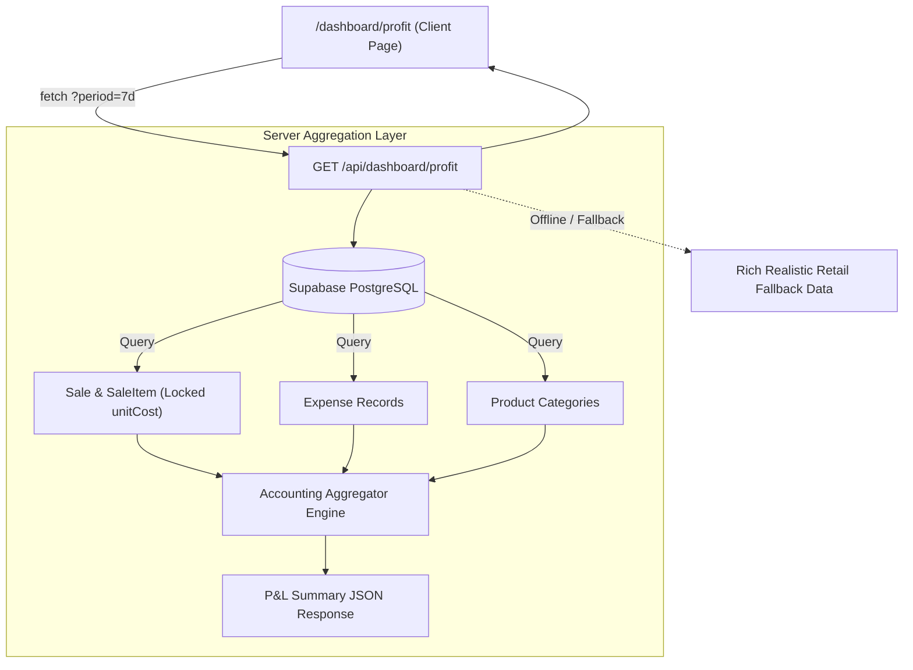

# Kipp Market — Profit & Loss (P&L) Analytics & Financial Dashboard Spec

**Date:** 2026-10-22  
**Status:** Approved  
**Author:** Pair Programming Agent & User  
**Target Module:** `/dashboard/profit` & `/api/dashboard/profit`

---

## 1. Overview & Business Intent

Kipp Market is a cloud-native retail management and POS platform designed for Thai convenience stores and supermarkets. While the main dashboard (`/dashboard`) provides operational overviews (hourly sales trends, active shifts, inventory warnings), store owners and executives require deep visibility into actual business profitability.

This specification defines the dedicated **Profit & Loss (P&L) Analytics System**:
1. **Accounting Engine**: Net-of-VAT revenue calculation, Moving Average Cost of Goods Sold (COGS), and store expense deductions.
2. **Server-Side Aggregation API (`/api/dashboard/profit`)**: High-performance querying across `Sale`, `SaleItem`, `Expense`, and `Product` tables in Supabase PostgreSQL with offline/demo resilience.
3. **Interactive Frontend Dashboard (`/dashboard/profit`)**: Consistent Dark Emerald & Lime Green palette (`#061a12`, `#bef264`) featuring 3 interactive visualizations:
   - Multi-bar trend comparison: Net Revenue vs COGS vs Net Profit with daily margin line.
   - Horizontal category profitability ranking (% Margin & absolute THB profit).
   - Top 10 Profit Drivers table distinguishing High Margin and Volume items.
4. **Navigation Integration**: Seamless sidebar entry under Finance & Expenses and cross-links from the main dashboard.

---

## 2. Retail Accounting Formulas & Principles

All financial calculations strictly adhere to standard Thai retail accounting:

```
[1] Gross Sales (ยอดขายรวมทั้งหมดในบิล)
    = Total customer payment tenders received (including 7% VAT)

[2] Net Revenue (ยอดขายสุทธิที่แท้จริงของร้าน)
    = Gross Sales / 1.07
    * Excludes 7% VAT which is collected on behalf of the Revenue Department.

[3] Cost of Goods Sold (COGS - ต้นทุนขาย)
    = SUM(SaleItem.quantity * SaleItem.unitCost)
    * Uses the moving average unit cost locked at the moment of sale in SaleItem.unitCost.

[4] Gross Profit (กำไรขั้นต้น)
    = Net Revenue - COGS

[5] Gross Margin Percentage (อัตรากำไรขั้นต้น %)
    = (Gross Profit / Net Revenue) * 100

[6] Store Expenses (ค่าใช้จ่ายดำเนินงานร้านค้า)
    = SUM(Expense.amount)
    * Extracted from the Expense ledger for the selected date range.

[7] Net Profit (กำไรสุทธิคงเหลือจริง)
    = Gross Profit - Store Expenses

[8] Net Margin Percentage (อัตรากำไรสุทธิ %)
    = (Net Profit / Net Revenue) * 100
```

---

## 3. System Architecture & Data Flow



---

## 4. API Specification (`GET /api/dashboard/profit`)

### 4.1 Query Parameters
- `period`: `today` | `7d` | `30d` | `month` | `year` (Default: `7d`)
- `tenantId`: string (extracted from session/cookie or parameter fallback)
- `branchId`: string (optional, defaults to primary active branch)

### 4.2 Response Schema
```typescript
export interface ProfitAnalyticsResponse {
  period: string;
  startDate: string;
  endDate: string;
  summary: {
    grossSales: number;        // ยอดขายรวม VAT
    vatAmount: number;         // ภาษี VAT 7%
    netRevenue: number;        // ยอดขายสุทธิก่อน VAT
    cogs: number;              // ต้นทุนขายรวม
    grossProfit: number;       // กำไรขั้นต้น
    grossMarginPercent: number;// % กำไรขั้นต้น
    totalExpenses: number;     // ค่าใช้จ่ายรวม
    netProfit: number;         // กำไรสุทธิคงเหลือ
    netMarginPercent: number;  // % กำไรสุทธิ
    totalOrders: number;       // จำนวนบิลทั้งหมด
    avgBasketProfit: number;   // กำไรเฉลี่ยต่อบิล
  };
  dailyTrend: Array<{
    date: string;
    dayLabel: string;
    netRevenue: number;
    cogs: number;
    expenses: number;
    netProfit: number;
    marginPercent: number;
  }>;
  categoryBreakdown: Array<{
    category: string;
    categoryTh: string;
    netRevenue: number;
    cogs: number;
    grossProfit: number;
    marginPercent: number;
    salesSharePercent: number;
  }>;
  topProfitDrivers: Array<{
    id: string;
    name: string;
    barcode: string;
    category: string;
    qtySold: number;
    avgSellingPrice: number;
    avgUnitCost: number;
    totalProfit: number;
    marginPercent: number;
    badge: "HIGH_MARGIN" | "VOLUME_DRIVER" | "CORE_STAPLE";
  }>;
}
```

---

## 5. User Interface & Visual Design

### 5.1 Design Tokens & Aesthetics
- **Theme**: Dark Emerald & Lime Green
  - Background: `#f8faf9`
  - Deep Emerald Cards & Headers: `#061a12`, `#0a2418`
  - Lime Accent: `#bef264`, `#84cc16`
  - Borders: `border-slate-200`, `border-emerald-800/30`
  - Text: `text-slate-900`, `text-slate-600`, mono typography for numbers (`font-mono`)

### 5.2 Page Sections (`src/app/dashboard/profit/page.tsx`)
1. **Header & Date Range Selector**:
   - Title: "รายงานกำไร-ขาดทุน & วิเคราะห์ผลประกอบการ" (Profit & Loss Analytics)
   - Subtitle: "วิเคราะห์อัตรากำไรสุทธิ ต้นทุนสินค้าจริง (COGS) และผลตอบแทนรายหมวดหมู่"
   - Quick Filter Pills: `[ วันนี้ | 7 วันล่าสุด | 30 วัน | เดือนนี้ ]`
   - Actions: Export CSV / PDF button, Store Branch selector dropdown.

2. **Top 4 KPI Financial Cards**:
   - Card 1: **ยอดขายสุทธิ (Net Revenue)** — `฿185,420.00` (หัก VAT 7% แล้ว)
   - Card 2: **ต้นทุนขายจริง (COGS)** — `-฿126,800.00` (สัดส่วน 68.4% ของยอดขาย)
   - Card 3: **กำไรขั้นต้น (Gross Profit)** — `฿58,620.00` (Margin 31.6%)
   - Card 4: **กำไรสุทธิคงเหลือ (Net Profit)** — `฿49,870.00` (Net Margin 26.9%) หลังหักค่าใช้จ่ายร้าน `฿8,750.00`

3. **Chart 1: Interactive Multi-Bar P&L Trend**:
   - Responsive SVG bar graph comparing **Net Revenue**, **COGS**, and **Net Profit** side-by-side for each date.
   - Overlaid dashed curve line tracking daily **Net Margin %**.
   - Hover tooltips detailing exact amounts and breakdown.

4. **Chart 2: Category Profitability & Margin Ranking**:
   - Horizontal comparative bars ranking product categories by Margin %.
   - Clear visual indicators of high-yield segments (e.g., Fresh Coffee & Drinks at 48%, Bakery at 40%, Ready Meals at 32%, Tobacco/Top-up at 7%).

5. **Table 3: Top 10 Profit Drivers (สินค้าสร้างกำไรสูงสุด)**:
   - Rank, Item Name, Barcode, Units Sold, Selling Price, Unit Cost, Total Profit (฿), Margin %.
   - Smart Badges:
     - `High Margin`: Margin > 40%
     - `Volume Driver`: Qty Sold > 100 units
     - `Core Staple`: High steady contribution

---

## 6. Integration Points

1. **`DashboardSidebar.tsx`**:
   - Add new entry under `FINANCE & EXPENSES`:
     - Label: `วิเคราะห์กำไร & การเงิน (Profit & Loss)`
     - Href: `/dashboard/profit`
     - Icon: `TrendingUp`
2. **`src/app/dashboard/page.tsx`**:
   - On the **Gross Profit KPI Card**, bind the `วิเคราะห์กำไร (Margin Analysis)` button to navigate directly to `/dashboard/profit`.
3. **`LanguageContext.tsx`**:
   - Add bilingual dictionary strings for Thai and English for all new financial metrics and chart labels.
4. **Resilience**:
   - Built-in fallback dataset guarantees smooth operation even when the database connection is offline or in local demo mode.
