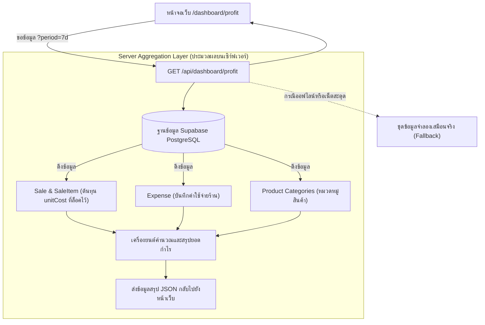

# Kipp Market — เอกสารข้อกำหนดระบบวิเคราะห์กำไร-ขาดทุน (P&L) & แดชบอร์ดการเงิน

**วันที่:** 22 ตุลาคม 2026  
**สถานะ:** อนุมัติแล้ว (Approved)  
**โมดูลเป้าหมาย:** `/dashboard/profit` และ `/api/dashboard/profit`

---

## 1. ภาพรวมและเป้าหมายทางธุรกิจ (Overview & Business Intent)

**Kipp Market** เป็นระบบจัดการร้านค้าปลีกและ POS บนคลาวด์สำหรับร้านสะดวกซื้อและมินิมาร์ทในไทย แม้ว่าหน้าแดชบอร์ดหลัก (`/dashboard`) จะให้ภาพรวมการดำเนินงานรายวัน (ยอดขายรายชั่วโมง, สถานะกะ, การแจ้งเตือนสต็อก) แต่เจ้าของร้านและผู้บริหารยังต้องการเครื่องมือเจาะลึกเพื่อดู **"กำไรที่แท้จริงของกิจการ"**

เอกสารนี้กำหนดข้อกำหนดสำหรับ **"ระบบวิเคราะห์กำไร-ขาดทุน (Profit & Loss Analytics System)"**:
1. **ระบบคำนวณกำไรตามมาตรฐานบัญชีค้าปลีก**: คำนวณยอดขายสุทธิตัด VAT 7% ออก, ต้นทุนขายจริง (COGS) จากต้นทุนเฉลี่ยที่ล็อคไว้ในแต่ละบิล, และหักค่าใช้จ่ายร้านค้า
2. **Server-Side Aggregation API (`/api/dashboard/profit`)**: ระบบสรุปผลตัวเลขทางการเงินความเร็วสูง ดึงข้อมูลจริงจาก Supabase PostgreSQL (`Sale`, `SaleItem`, `Expense`, `Product`) พร้อมระบบสำรองข้อมูลออฟไลน์ (Offline/Demo Resilience)
3. **หน้าจอแดชบอร์ดวิเคราะห์กำไร (`/dashboard/profit`)**: ดีไซน์ธีม Dark Emerald & Lime Green (`#061a12`, `#bef264`) พร้อมกราฟวิเคราะห์ 3 รูปแบบ:
   - กราฟแท่งเปรียบเทียบ 3 มิติ: ยอดขาย vs ต้นทุน vs กำไรสุทธิ พร้อมเส้นแสดงอัตรากำไร (Margin %) รายวัน
   - กราฟแท่งแนวนอนจัดอันดับอัตรากำไร % แยกตามหมวดหมู่สินค้า
   - ตาราง 10 สินค้าทำเงินเข้ากระเป๋าร้านสูงสุด (Top 10 Profit Drivers)
4. **การเชื่อมโยงระบบเดิม**: เพิ่มเมนูในแถบ Sidebar ภายใต้หัวข้อการเงิน และเชื่อมปุ่ม "วิเคราะห์กำไร" จากหน้าแรกให้กดทะลุเข้ามาดูได้ทันที

---

## 2. สูตรและหลักการคำนวณทางบัญชี (Retail Accounting Formulas)

การคำนวณตัวเลขทางการเงินทั้งหมด ยึดตามหลักมาตรฐานบัญชีค้าปลีกของไทย:

```
[1] ยอดขายรวมทั้งหมด (Gross Sales)
    = ยอดเงินรวมทั้งหมดที่ได้รับจากลูกค้า (รวมภาษีมูลค่าเพิ่ม VAT 7%)

[2] ยอดขายสุทธิที่แท้จริงของร้าน (Net Revenue)
    = ยอดขายรวม (Gross Sales) / 1.07
    * หักภาษีมูลค่าเพิ่ม VAT 7% ออก เพราะเป็นเงินที่ต้องนำส่งกรมสรรพากร ไม่ใช่รายได้ของร้าน

[3] ต้นทุนขายจริง (COGS - Cost of Goods Sold)
    = ผลรวมของ (จำนวนชิ้นที่ขาย x ราคาทุนเฉลี่ย ณ วันที่ขาย)
    * ดึงจากต้นทุนเฉลี่ยที่ถูกล็อคค่าไว้ในตาราง SaleItem.unitCost ตอนคิดเงิน

[4] กำไรขั้นต้น (Gross Profit)
    = ยอดขายสุทธิ (Net Revenue) - ต้นทุนขายจริง (COGS)

[5] อัตรากำไรขั้นต้น (Gross Margin %)
    = (กำไรขั้นต้น / ยอดขายสุทธิ) x 100

[6] ค่าใช้จ่ายดำเนินงานร้านค้า (Store Expenses)
    = ผลรวมค่าใช้จ่ายทั้งหมดในตาราง Expense ตามช่วงเวลาที่เลือก (เช่น ค่าไฟ, ค่าเช่า, ค่าถุงหิ้ว)

[7] กำไรสุทธิคงเหลือจริง (Net Profit)
    = กำไรขั้นต้น (Gross Profit) - ค่าใช้จ่ายร้านค้า (Store Expenses)

[8] อัตรากำไรสุทธิ (Net Margin %)
    = (กำไรสุทธิ / ยอดขายสุทธิ) x 100
```

---

## 3. สถาปัตยกรรมระบบและการไหลของข้อมูล (System Architecture & Data Flow)



---

## 4. ข้อกำหนด API (`GET /api/dashboard/profit`)

### 4.1 พารามิเตอร์ที่รับเข้า (Query Parameters)
- `period`: `today` (วันนี้) | `7d` (7 วันล่าสุด) | `30d` (30 วันล่าสุด) | `month` (เดือนนี้) | `year` (ปีนี้) — ค่าเริ่มต้นคือ `7d`
- `tenantId`: รหัสร้านค้า (ดึงจาก Session หรือ Parameter)
- `branchId`: รหัสสาขา (ดึงจากสาขาที่เลือกใช้งาน)

### 4.2 โครงสร้างข้อมูลที่ตอบกลับ (Response Schema)
```typescript
export interface ProfitAnalyticsResponse {
  period: string;             // ช่วงเวลาที่เลือก
  startDate: string;          // วันที่เริ่มต้น
  endDate: string;            // วันที่สิ้นสุด
  summary: {
    grossSales: number;        // ยอดขายรวม VAT (บาท)
    vatAmount: number;         // ภาษีมูลค่าเพิ่ม 7% (บาท)
    netRevenue: number;        // ยอดขายสุทธิก่อน VAT (บาท)
    cogs: number;              // ต้นทุนขายรวม (บาท)
    grossProfit: number;       // กำไรขั้นต้น (บาท)
    grossMarginPercent: number;// อัตรากำไรขั้นต้น (%)
    totalExpenses: number;     // ค่าใช้จ่ายร้านค้ารวม (บาท)
    netProfit: number;         // กำไรสุทธิคงเหลือ (บาท)
    netMarginPercent: number;  // อัตรากำไรสุทธิ (%)
    totalOrders: number;       // จำนวนบิลทั้งหมด
    avgBasketProfit: number;   // กำไรเฉลี่ยต่อบิล (บาท)
  };
  dailyTrend: Array<{
    date: string;              // วันที่ (YYYY-MM-DD)
    dayLabel: string;          // ชื่อวัน เช่น "จันทร์ 16", "อังคาร 17"
    netRevenue: number;        // ยอดขายสุทธิของวันนั้น
    cogs: number;              // ต้นทุนของวันนั้น
    expenses: number;          // ค่าใช้จ่ายของวันนั้น
    netProfit: number;         // กำไรสุทธิของวันนั้น
    marginPercent: number;     // % กำไรของวันนั้น
  }>;
  categoryBreakdown: Array<{
    category: string;          // รหัสหมวดหมู่
    categoryTh: string;        // ชื่อหมวดหมู่ภาษาไทย
    netRevenue: number;        // ยอดขายของหมวดนี้
    cogs: number;              // ต้นทุนของหมวดนี้
    grossProfit: number;       // กำไรของหมวดนี้
    marginPercent: number;     // % กำไรของหมวดนี้
    salesSharePercent: number; // สัดส่วนยอดขายเทียบทั้งร้าน (%)
  }>;
  topProfitDrivers: Array<{
    id: string;                // รหัสสินค้า
    name: string;              // ชื่อสินค้า
    barcode: string;           // บาร์โค้ด
    category: string;          // หมวดหมู่
    qtySold: number;           // จำนวนชิ้นที่ขายได้
    avgSellingPrice: number;   // ราคาขายเฉลี่ยต่อชิ้น
    avgUnitCost: number;       // ราคาทุนเฉลี่ยต่อชิ้น
    totalProfit: number;       // กำไรรวมที่ทำได้ (บาท)
    marginPercent: number;     // % กำไรต่อชิ้น
    badge: "HIGH_MARGIN" | "VOLUME_DRIVER" | "CORE_STAPLE"; // ป้ายกำกับ
  }>;
}
```

---

## 5. การออกแบบหน้าจอและกราฟ (`src/app/dashboard/profit/page.tsx`)

### 5.1 ธีมและเอกลักษณ์การออกแบบ (Design Tokens)
- **โทนสี**: Dark Emerald & Lime Green สไตล์การเงินพรีเมียม
  - พื้นหลังหน้าจอ: `#f8faf9`
  - การ์ดและหัวข้อหลัก: `#061a12`, `#0a2418`
  - สีไฮไลท์กำไร: เขียวมะนาว `#bef264`, `#84cc16`
  - ขอบเส้น: `border-slate-200`, `border-emerald-800/30`
  - ตัวเลข: ใช้ฟอนต์ Monospace (`font-mono`) อ่านง่ายชัดเจน

### 5.2 ส่วนประกอบหน้าจอ 5 โซนหลัก
1. **แถบหัวข้อและเลือกช่วงเวลา (Header & Time Filter)**:
   - ชื่อหน้า: "รายงานกำไร-ขาดทุน & วิเคราะห์ผลประกอบการ (Profit & Loss Analytics)"
   - คำอธิบาย: "วิเคราะห์อัตรากำไรสุทธิ ต้นทุนสินค้าจริง (COGS) และผลตอบแทนรายหมวดหมู่"
   - ปุ่มเลือกช่วงเวลา: `[ วันนี้ | 7 วันล่าสุด | 30 วัน | เดือนนี้ ]`
   - ปุ่มดาวน์โหลดรายงาน: ส่งออกข้อมูลเป็นไฟล์ Excel (CSV)
   - เมนูเลือกสาขา: สลับดูระหว่างสาขาได้

2. **การ์ดสรุปตัวเลขทางการเงิน 4 การ์ด (Top KPI Cards)**:
   - การ์ด 1: **ยอดขายสุทธิ (Net Revenue)** — หัก VAT 7% แล้ว (เช่น `฿185,420.00`)
   - การ์ด 2: **ต้นทุนขายจริง (COGS)** — สัดส่วนต้นทุนเทียบยอดขาย (เช่น `-฿126,800.00` คิดเป็น `68.4%`)
   - การ์ด 3: **กำไรขั้นต้น (Gross Profit)** — พร้อมอัตรากำไรขั้นต้น (เช่น `฿58,620.00` คิดเป็น `Margin 31.6%`)
   - การ์ด 4: **กำไรสุทธิคงเหลือ (Net Profit)** — การ์ดไฮไลท์สีเขียวมรกตตัวเลขเขียวมะนาวเด่นชัด หลังหักค่าใช้จ่ายร้าน (เช่น `฿49,870.00` คิดเป็น `Net Margin 26.9%`)

3. **กราฟที่ 1: กราฟแท่งเปรียบเทียบ 3 มิติ (Revenue vs COGS vs Net Profit Interactive Chart)**:
   - แสดงแท่งเปรียบเทียบ 3 สีในแต่ละวัน:
     - **แท่งเขียวเข้ม**: ยอดขายของวันนั้น
     - **แท่งสีเทา**: ต้นทุนสินค้าของวันนั้น
     - **แท่งเขียวมะนาว**: กำไรสุทธิของวันนั้น
   - มีเส้นประพาดบนแสดงแนวโน้ม **อัตรากำไร % (Daily Margin %)** ประจำวัน
   - มี Hover Tooltip เอาเมาส์ชี้เพื่อดูตัวเลขละเอียดของแต่ละวันได้ทันที

4. **กราฟที่ 2: กราฟแท่งแนวนอนจัดอันดับกำไรรายหมวดหมู่ (Category Profitability)**:
   - จัดอันดับหมวดหมู่สินค้าที่ทำกำไรคุ้มที่สุดในร้าน เรียงจากมากไปน้อย (เช่น กาแฟ & เครื่องดื่มชง 48%, เบเกอรี่ 40%, อาหารพร้อมทาน 32%, ขนมขบเคี้ยว 24%, บุหรี่ & บัตรเติมเงิน 7%)
   - มีแถบสีเขียวแสดงเปอร์เซ็นต์ Margin % ชัดเจน

5. **ตารางที่ 3: 10 สินค้าทำกำไรเข้ากระเป๋าร้านสูงสุด (Top 10 Profit Drivers)**:
   - ตารางแสดงสินค้า 10 อันดับแรกที่สร้างกำไรเป็นเงินบาทได้มากที่สุด
   - คอลัมน์: ลำดับ, ชื่อสินค้า, บาร์โค้ด, จำนวนที่ขายได้, ราคาขาย, ราคาทุน, กำไรรวมเป็นเงินบาท, และ Margin %
   - ป้ายกำกับอัจฉริยะ (Smart Badges):
     - `กำไรสูง (High Margin)`: สินค้าที่ได้กำไรต่อชิ้นมากกว่า 40%
     - `ขายดีเน้นจำนวน (Volume Driver)`: สินค้าที่ขายได้จำนวนมาก สร้างเงินหมุนเวียนหลัก
     - `สินค้าหลักประจำร้าน (Core Staple)`: สินค้าที่ทำกำไรต่อเนื่องสม่ำเสมอ

---

## 6. การเชื่อมต่อกับระบบเดิม (Integration Points)

1. **แถบเมนูนำทางด้านซ้าย ([DashboardSidebar.tsx](file:///c:/KippMarket/src/components/dashboard/DashboardSidebar.tsx))**:
   - เพิ่มเมนูใหม่ในหมวด `การเงิน & ค่าใช้จ่าย`:
     - ชื่อเมนู: `วิเคราะห์กำไร & การเงิน (Profit & Loss)`
     - ลิงก์: `/dashboard/profit`
     - ไอคอน: `TrendingUp`
2. **การ์ดหน้าแรก ([src/app/dashboard/page.tsx](file:///c:/KippMarket/src/app/dashboard/page.tsx))**:
   - ผูกปุ่ม `วิเคราะห์กำไร (Margin Analysis) →` ที่การ์ด Gross Profit ให้กดแล้วเปิดมายังหน้านี้ทันที
3. **พจนานุกรมแปลภาษา ([LanguageContext.tsx](file:///c:/KippMarket/src/context/LanguageContext.tsx))**:
   - เพิ่มคำแปลภาษาไทยและภาษาอังกฤษสำหรับคำศัพท์การเงิน กราฟ และตารางกำไรทั้งหมด
4. **ความทนทานต่อระบบออฟไลน์ (Resilience)**:
   - หากขาดการเชื่อมต่ออินเทอร์เน็ต ระบบจะมีชุดข้อมูลจำลองที่สมบูรณ์รองรับทันที ทำให้หน้าจอแสดงผลได้รวดเร็ว ไม่ค้าง ไม่หมุนติ้ว
